<div align="center">


<br/>

[](https://git.io/typing-svg)

<br/>

<p>
  <a href="https://shanttoosh-dev.vercel.app">
    
  </a>
  &nbsp;
  <a href="https://www.linkedin.com/in/shanttoosh-v-470484289/">
    
  </a>
  &nbsp;
  <a href="mailto:shanttoosh@gmail.com">
    
  </a>
  &nbsp;
  <a href="https://github.com/shanttoosh">
    
  </a>
  &nbsp;
  
</p>

<p>
  <b>Live now:</b>
  <a href="https://thesis-research-nu.vercel.app">Thesis</a> ·
  <a href="https://qms-copilot-two.vercel.app">AI Complaint Copilot</a> ·
  <a href="https://vaultmind-nine.vercel.app">VaultMind</a>
</p>

<br/>

</div>

---

##  About Me

```python
class Shanttoosh:
    role        = "AI Developer @ Krion Consulting Pvt Ltd"
    location    = "Chennai, India 🇮🇳"
    education   = "B.E. Computer Science — Meenakshi College of Engineering (2021–2025)"
    focus       = ["NL2SQL", "Multi-Agent LLMs", "RAG Pipelines", "AI Automation"]
    stack       = ["Python", "FastAPI", "LangGraph", "LangChain", "PostgreSQL", "TypeScript"]
    currently   = "Building AI products for the construction industry at Krion Consulting"
    open_to     = "AI collaborations, challenging problems, and knowledge sharing"
    fun_fact    = "I build AI that doesn't just respond — it reasons, retrieves, and delivers 🚀"
```

<br/>

---

##  Work Experience

<br/>

<table width="100%" cellspacing="0" cellpadding="12">
<tr>
<td width="11%" align="center" valign="top">
<br/>
<a href="https://krionconsulting.com">

</a>
<br/><br/>

</td>
<td width="89%" valign="top">

###  [Krion Consulting Pvt Ltd](https://krionconsulting.com/) — AI Developer
**Dec 2025 – Present &nbsp;|&nbsp; 📍 Chennai, India**

> Building AI products for the construction industry: natural-language analytics, multi-agent systems and computer vision for drawings.

-  Engineered an **AI-powered SQL assistant**: hybrid deterministic routing with LangChain multi-agent reasoning, schema-aware NL2SQL, validation loops and semantic caching, with **20% lower average query latency**
-  Built a **multi-agent construction intelligence system**: an orchestrator routing questions across 10+ specialised agents, using Anthropic, OpenAI and Gemini models
-  Engineered an **AI quantity take-off system** for construction drawings: computer-vision pipelines for scale detection, wall and room reconstruction, symbol recognition and BOQ generation
-  Full-stack delivery: FastAPI services · NestJS · Angular and React · PostgreSQL and Redis · Docker

<p>


</p>

</td>
</tr>
</table>

<br/>

<table width="100%" cellspacing="0" cellpadding="12">
<tr>
<td width="11%" align="center" valign="top">
<br/>
<a href="https://www.iopex.com">

</a>
<br/><br/>

</td>
<td width="89%" valign="top">

###  [iOPEX Technologies](https://www.iopex.com/) — AI/ML Intern
**Jul 2025 – Oct 2025 &nbsp;|&nbsp; 📍 Chennai, India**

> Worked on RAG pipelines, embedding workflows and document processing systems for enterprise applications.

-  **Led a 6-member team** architecting an end-to-end chunking optimizer supporting **5 chunking strategies** and **4 execution modes**, improving retrieval accuracy across diverse document types
-  Built **high-throughput embeddings pipeline** (~60s per 100K rows) using 6-worker parallelism with sentence-transformers
-  Delivered **RAG-ready semantic search** via FAISS/Chroma with cosine similarity and metadata filtering
-  Developed **OpenAI-compatible REST APIs** with LangChain-orchestrated pipelines and a React UI

<p>


</p>

</td>
</tr>
</table>

<br/>

<table width="100%" cellspacing="0" cellpadding="12">
<tr>
<td width="11%" align="center" valign="top">
<br/>
<a href="https://www.velozityglobal.com">

</a>
<br/><br/>

</td>
<td width="89%" valign="top">

###  [Velozity Global Solutions](https://www.velozityglobal.com/) — Machine Learning Intern
**Feb 2025 – Apr 2025 &nbsp;|&nbsp; 📍 Chennai, India**

> Applied machine learning for biomedical signal processing and ECG analysis.

-  Developed **ECG signal preprocessing pipeline** with noise filtering, baseline correction, and heartbeat segmentation for accurate downstream analysis
-  Implemented advanced ECG visualisations — **PQRST annotation**, spectrogram analysis, and phase space plotting
-  Curated, formatted, and validated ECG datasets for ML-ready model training pipelines

<p>


</p>

</td>
</tr>
</table>

<br/>

---

## 🎓 Education

<br/>

<table width="100%" cellspacing="0" cellpadding="12">
<tr>
<td width="11%" align="center" valign="top">
<br/>
<a href="https://mce.edu.in">

</a>
<br/><br/>

</td>
<td width="89%" valign="top">

### 🎓 [Meenakshi College of Engineering](https://mce.edu.in/) — B.E. Computer Science
**Oct 2021 – May 2025 &nbsp;|&nbsp;  Chennai, India &nbsp;|&nbsp;  GPA: 7.62 / 10**

> Anna University affiliated institution. Strong foundations in engineering and applied computer science.

-  Core focus: Machine Learning, Database Systems, Data Structures & Algorithms, Artificial Intelligence
-  Built multiple AI/ML projects across NLP, computer vision, and data analytics through academic years
-  Active participation in technical clubs and inter-college project competitions

<p>


</p>

</td>
</tr>
</table>

<br/>

---

##  Featured Projects

<br/>

<table width="100%">
<tr>
<td width="50%" valign="top">

###  [Thesis](https://github.com/shanttoosh/thesis)

    

> AI trading research assistant

**What it does:** Turns a vague market question into a precisely specified, testable experiment, runs it against historical data, and keeps what the data shows apart from what the system concludes.

- Next.js and React frontend, Fastify backend, Zod schemas shared by both
- PostgreSQL with Drizzle
- Pluggable LLM port: Claude, Groq gpt-oss-120b or an offline stub
- **[▶ Open live](https://thesis-research-nu.vercel.app)**

</td>
<td width="50%" valign="top">

###  [Agentic AI RAG Chatbot](https://github.com/shanttoosh/agentic-ai-rag-chatbot)

    

> Grounded answers from one document

**What it does:** A document-grounded assistant that answers only from a 60-page Agentic AI eBook, verifies every claim against the retrieved chunks, and says so when the book does not cover a question.

- LangGraph StateGraph with typed state and conditional edges
- Pinecone serverless index with hosted embeddings
- Groq gpt-oss-120b answers; gpt-oss-20b checks every claim
- 135 offline pytest tests, mypy --strict and GitHub Actions

</td>
</tr>

<tr>
<td width="50%" valign="top">

###  [AI Complaint Management Copilot](https://github.com/shanttoosh/ai-complaint-management-system)

     

> Conversational copilot for a pharma QMS

**What it does:** A QA officer pastes an email or attaches a document, and the copilot fills a structured customer complaint record, then follows corrections given in plain language.

- AI risk classification with a 0–100 score, severity and priority
- Completeness checks with follow-up questions, and duplicate detection
- Root cause and CAPA recommendations tied to manufacturing stages
- **[▶ Open live](https://qms-copilot-two.vercel.app)**

</td>
<td width="50%" valign="top">

###  [VaultMind](https://github.com/shanttoosh/Obsidian_vault_RAG_knowledge_assistant)

    

> RAG assistant for an Obsidian vault

**What it does:** Ask questions in plain language and get answers drawn strictly from your own notes, with wikilink citations to every source, or an explicit "not found in your vault".

- Hybrid search: vector and lexical indexes fused with RRF
- Cited answers with a grounding grade
- Agentic deep research across linked notes, with human-approved write-back
- **[▶ Open live](https://vaultmind-nine.vercel.app)**

</td>
</tr>

<tr>
<td width="50%" valign="top">

###  [n8n Engagement Pipeline](https://github.com/shanttoosh/n8n-engagement-pipeline)

   

> 7-pipeline AI prospecting and DM automation bot

**What it does:** Full-stack social media outreach automation — scrapes leads, scores them 0–100, auto-follows, generates personalised Groq AI DMs, runs multi-step follow-ups, and emails daily HTML reports.

- 46-node n8n workflow in a single importable file
- 4 distinct Groq Llama 3 DM personas
- Lead scoring: follower + engagement + bio signals
- Randomised delays and rate-limit safety design

</td>
<td width="50%" valign="top">

###  [Shopify AI Analytics](https://github.com/shanttoosh/shopify-ai-analytics)

   

> Agentic analytics platform for Shopify stores

**What it does:** Answers natural language business questions about inventory, sales, and customers using a 6-step agentic workflow that generates ShopifyQL and returns actionable insights.

- Multi-service: Node.js gateway + Python AI service
- 6-step workflow: Intent → Plan → Generate → Execute → Process → Explain
- Shopify OAuth 2.0 + mock mode for dev
- Docker Compose for full local deployment

</td>
</tr>

<tr>
<td width="50%" valign="top">

###  [Lease Document Chat System](https://github.com/shanttoosh/AI-Powered-Lease-Document-Chat-System)

   

> RAG-powered PDF Q&A with structured extraction

**What it does:** Ingests legal lease PDFs, extracts **25+ structured fields** into CSV, and enables chat-based Q&A with source-cited answers pointing to exact page numbers.

- Extracts parties, dates, rent, options, default clauses
- Semantic search via ChromaDB + sentence-transformers
- Citations like `[Source 1 – Page 17]` on every answer
- CLI: `--extract-only` mode or full interactive chat

</td>
<td width="50%" valign="top">

###  More on GitHub

- **[Voice-Controlled AI Agent](https://github.com/shanttoosh/voice-controlled-ai-agent):** transcribes a spoken command, picks one of four tools and keeps file writes in a sandbox
- **[Lead Pipeline Automation](https://github.com/shanttoosh/Lead-Pipeline-Automation):** pulls local businesses from Google Maps, checks their site speed and ad tracking, and exports leads
- **[LLM Evaluation Pipeline](https://github.com/shanttoosh/llm-response-evaluator):** scores chatbot replies for relevance and hallucination with an LLM judge
- **Classic ML:** [customer segmentation](https://github.com/shanttoosh/Customer_Segmentation_using_Kmeans), [churn prediction](https://github.com/shanttoosh/customer_churn_prediction) and [fraud detection](https://github.com/shanttoosh/Predicting-Fraudlent-Transactions) notebooks

</td>
</tr>
</table>

<br/>

---

##  Tech Stack

###  AI / ML & LLMs


###  Languages & Backend


###  Databases & Vector Stores


###  Frontend


###  Data & Visualisation


###  DevOps, Tools & Automation


<br/>

---

##  GitHub Stats

<div align="center">


&nbsp;


<br/><br/>


</div>

<br/>

---

##  Certifications

<div align="center">

[](https://www.coursera.org/account/accomplishments/specialization/KZRI2FDF5ZW8)
&nbsp;
[-E37400?style=for-the-badge&logo=google-analytics&logoColor=white)](https://skillshop.credential.net/40b06d26-dfb3-4afe-b20f-b95167a8f68a)

</div>

<br/>

---

##  Interests & Focus Areas

<div align="center">

| 🤖 Multi-Agent LLM Systems | 🔍 NL2SQL & Semantic Retrieval | ⚙️ Backend API Engineering |
|:---:|:---:|:---:|
| Orchestrated AI agents with LangGraph & LangChain for complex multi-step reasoning | Translating natural language into accurate SQL across large real-world production schemas | High-performance REST APIs with FastAPI, NestJS, and Node.js |

| 🔗 AI Automation Pipelines | 📄 Document Intelligence | 📊 Data Analytics & BI |
|:---:|:---:|:---:|
| End-to-end automation with n8n, agentic workflows, and event-driven architectures | RAG-based Q&A, structured extraction, and compliance verification systems | From raw data to insights with SQL, Python, Pandas, and Tableau |

</div>

<br/>

---

##  Contribution Graph

<div align="center">

</div>

<br/>

---

<div align="center">


**✨ "Build AI that doesn't just respond — it reasons, retrieves, and delivers." ✨**

<br/>


</div>
